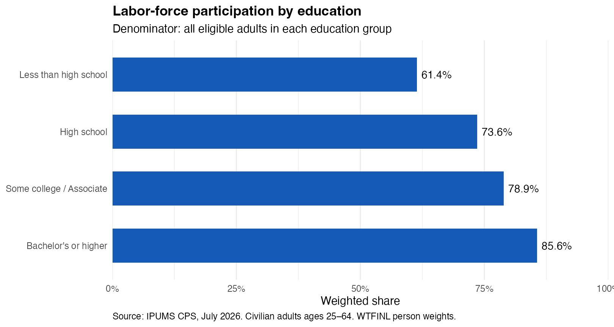
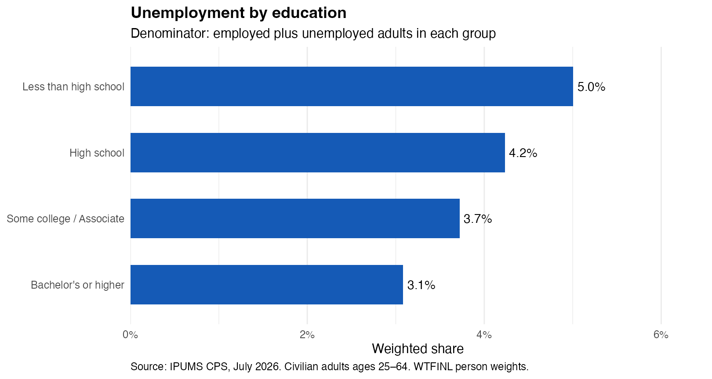
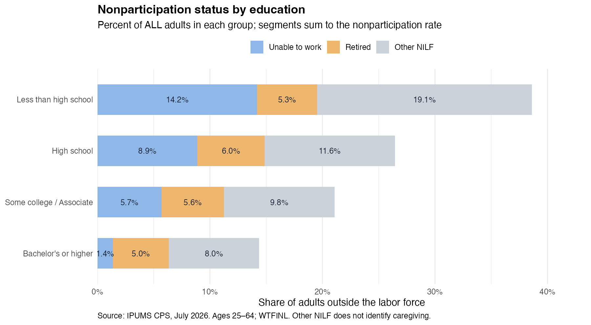

When people discuss education and employment, they often focus on unemployment. Yet the unemployment rate excludes people outside the labor force. A group can therefore have relatively low unemployment even when many of its members are not working. How do labor-market outcomes differ by education, and what recorded statuses help explain the participation gap?

This distinction matters because searching unsuccessfully for a job is different from being retired, unable to work, or outside the labor force for another reason. Looking only at unemployment can obscure these differences and lead us to misunderstand what the employment gap represents.

I use the July 2026 Basic Monthly Current Population Survey obtained through [IPUMS CPS](https://cps.ipums.org/cps/), covering civilian adults ages 25–64 in four education groups. All estimates use the final basic person weight. The retained sample contains 44,881 respondents. These are descriptive estimates for one month, without seasonal adjustment.

Figure 1 asks who is in the labor force: adults who are employed or classified as unemployed. Participation rose from 61.4% among adults without a high school diploma to 73.6% among high school graduates, 78.9% among those with some college or an associate degree, and 85.6% among those with a bachelor's degree or higher. The difference between the first and last groups was 24.2 percentage points.

Participation includes unsuccessful job seekers, so the next step is to ask how many adults actually had jobs, using the same population denominator.

Employment rose from 58.3% in the lowest education group to 70.4%, 76.0%, and 83.0% in the next three groups. The 24.7-percentage-point employment gap was close to the participation gap. This points toward nonparticipation as a major part of the difference, rather than only difficulty finding work among participants.

Figure 2 changes the denominator to employed plus unemployed adults. Unemployment fell from 5.0% in the lowest education group to 4.2%, 3.7%, and 3.1% as education increased. Its 1.9-percentage-point gap was much smaller than the participation gap. These figures are linked by an identity: employment share equals participation rate multiplied by one minus unemployment rate. Someone outside the labor force lowers participation and employment, but does not enter the unemployment denominator.

What, then, lies behind nonparticipation? The existing employment-status variable distinguishes “unable to work,” “retired,” and “other” among adults outside the labor force. Figure 3 separates these categories, keeping all adults in each education group as the denominator.

Among adults without a high school diploma, 14.2% were classified as unable to work, 5.3% as retired, and 19.1% as other nonparticipants. Among those with a bachelor's degree or higher, the corresponding shares were 1.4%, 5.0%, and 8.0%. These categories sum to nonparticipation rates of 38.6% and 14.4%.

The unable-to-work difference accounts arithmetically for 12.8 percentage points, or about 53% of the 24.2-point participation gap. Other nonparticipation accounts for 11.1 points, while retirement contributes only about 0.3 points. The largest identifiable category difference is therefore inability to work, rather than retirement. This moves the analysis beyond the employment ranking toward the circumstances associated with nonparticipation.

The interpretation has limits. A recorded inability to work is not proof that education caused poor health or that education alone would remove a barrier to working. The “other” category also cannot be labeled caregiving: this extract lacks the additional activity variable needed to identify caring for home or family separately. A fuller explanation would add that information and examine age and other differences across education groups. These comparisons are not causal estimates, and no statistical-significance claims are made.

- Employment rose from 58.3% to 83.0% across the lowest and highest education groups.
- Nonparticipation, especially the unable-to-work category, accounts for much of the descriptive gap.
- Retirement explains little of this gap; the contribution of caregiving remains unmeasured in this extract.

## Sources and replication

Source: IPUMS CPS, University of Minnesota, July 2026 Basic Monthly sample. See [person-weight documentation](https://cps.ipums.org/cps-action/variables/WTFINL), [employment-status definitions](https://cps.ipums.org/cps-action/variables/EMPSTAT), and [activity-variable documentation](https://cps.ipums.org/cps-action/variables/NILFACT). [Code, aggregate data, and step-by-step replication instructions](https://github.com/ywang818-max/website/tree/main/blog/posts/post3) reproduce the three article figures, supplementary employment chart, and tables; the README also explains how to rebuild them from an authorized IPUMS microdata extract.
