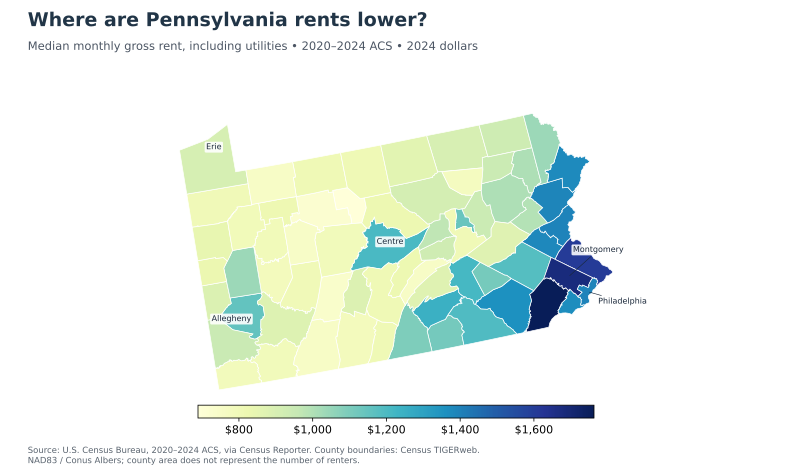
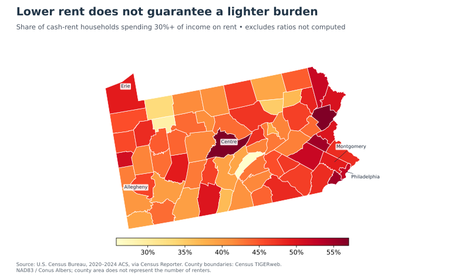
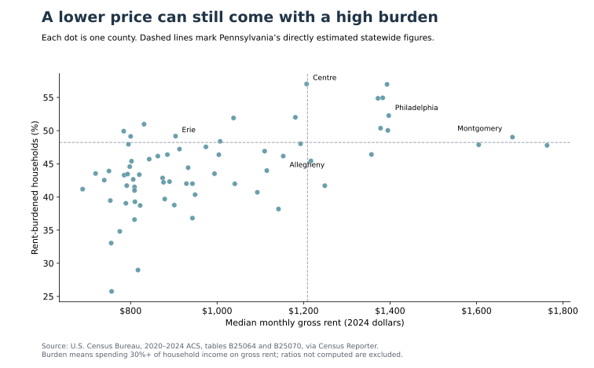

A low advertised rent can make a place look affordable. But for someone deciding where to live and work, the monthly price is only half the question: what income will be available to pay it? A smaller housing bill may still leave little for food, transportation, or emergencies. Across Pennsylvania, do counties with lower rents also have lighter rental burdens?

This matters for renters weighing a move and for communities trying to make housing affordable. Comparing prices alone can steer attention toward expensive places while overlooking financial pressure in cheaper ones. To see both sides, I examine rent levels, then the share of households strained by rent, and finally the income differences behind a revealing county comparison.

The data cover all 67 Pennsylvania counties in the Census Bureau’s 2020–2024 American Community Survey, obtained through Census Reporter. These are five-year estimates, not a snapshot of today’s listings. “Gross rent” includes rent and utilities; monetary values are expressed in 2024 dollars. County boundaries come from Census TIGERweb.

The first map shows a strong price contrast. Much of central and western Pennsylvania has lower rents than the southeastern counties around Philadelphia. Allegheny County, which contains Pittsburgh, has a median gross rent of $1,153; Erie County’s is $904. Montgomery County’s $1,683 is substantially higher. A renter comparing only those prices might reasonably expect Erie to offer the easiest budget.

That expectation leads to the second map: how much pressure do renters actually face relative to their incomes?

Here, rental burden means spending at least 30% of household income on gross rent. Statewide, 48.2% of households with a computable ratio meet that threshold. The calculation excludes 121,321 cash-rent households for which the Census does not compute the ratio; they are not classified as unburdened.

The burden map does not simply reproduce the price map. Philadelphia has both relatively high rent and a high burden share, at 52.3%. But pressure also appears away from the southeast: Erie’s share is 49.2%, and Centre County’s is 57.0%. In contrast, Allegheny’s is 46.2%. These estimates suggest that an affordability discussion focused only on the most expensive counties would miss other places where many renters face constrained budgets.

The scatterplot brings the two maps together. Counties with similar prices can have different burdens, and substantially different prices can accompany similar burdens. Erie and Montgomery illustrate the latter: their median rents differ by $779 per month, yet both have burden shares near 49%.

Their renter incomes help explain why price alone is incomplete. Median annual renter-household income is $34,870 in Erie, compared with $65,931 in Montgomery. Lower rent comes alongside lower resources to pay it. These separate medians do not describe the same household, so dividing them would not reproduce the measured burden share. Instead, the household-level rent-to-income categories provide that share directly.

This is descriptive evidence, not proof that local jobs caused the pattern. Household income includes sources beyond wages; the analysis does not measure job availability, hours worked, housing quality, or neighborhood safety. County averages also hide differences within communities. Survey estimates carry uncertainty, so small percentage differences should not be treated as established rankings. Large counties occupy more map space without necessarily containing more renters.

The answer is therefore qualified: lower rents can help, but they do not guarantee that housing is easy for local residents to afford. For an individual move, the useful comparison is the full housing bill against the income that household expects to receive.

- Read rent prices alongside renter incomes and actual burden shares.
- Erie and Montgomery have very different rents but similar estimated burdens.
- Housing pressure extends beyond Pennsylvania’s highest-rent counties.

## Sources and replication

U.S. Census Bureau, **2020–2024 ACS five-year estimates**, tables [B25064: median gross rent](https://api.census.gov/data/2024/acs/acs5/groups/B25064.html), [B25070: gross rent as a percentage of household income](https://api.census.gov/data/2024/acs/acs5/groups/B25070.html), and [B25119: household income by tenure](https://api.census.gov/data/2024/acs/acs5/groups/B25119.html), retrieved through [Census Reporter](https://censusreporter.org/about/) on October 19, 2026 (Eastern time). Maps use the [Census TIGERweb county layer](https://tigerweb.geo.census.gov/arcgis/rest/services/TIGERweb/State_County/MapServer/1), projected to NAD83 / Conus Albers. [Code, archived data, figures, and replication instructions](https://github.com/ywang818-max/website/tree/main/blog/posts/post5) are available on GitHub; the [county results table](results/county_analysis.csv) provides all 67 counties.
