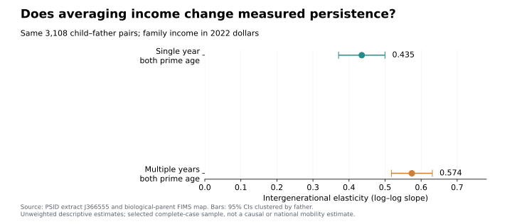
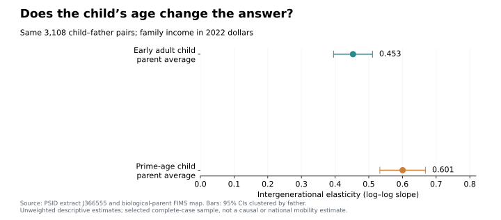

Would a graduate student’s income today tell us where they will stand at forty? Probably not. The same problem matters when comparing children with their parents: a convenient single-year observation can give a misleading picture of long-run economic mobility. This tutorial uses Python’s SQLite interface to build a defensible parent–child match, then asks how averaging income and changing the child’s measurement age affect the answer.

## 1. Build identities before joining incomes

The Panel Study of Income Dynamics (PSID) follows families and their descendants. I use a 261-variable, 85,536-person extract covering available interview waves from 1968 through 2023, plus a biological-parent FIMS mapping. The income measure is **family money income**, not individual earnings.

Download your own authorized extract and keep the ASCII file, Stata reading statements, and codebook together. The repository’s Python script reads fixed-width positions from those statements; opening the file as a comma-separated CSV would misalign its fields. The code excerpts below explain parts of the full script; they are not a standalone sequence to paste into a new Python session. For the complete import, matching, estimation and exports, install the packages listed in the README and run this command from `blog/posts/post6`, using your local paths:

```bash
python code/analyze.py --data /path/J366555.txt \
  --statements /path/J366555.do --fims /path/fim16218_gid_BO_2_UBL.txt
```

A permanent person ID combines the 1968 family identifier and person number. FIMS supplies explicit child and father IDs; sharing an original family identifier alone does not establish parenthood. A separate family interview ID changes across waves. Therefore, connect a person’s membership record to family income using **both wave and family ID**:

```sql
SELECT m.pid, m.wave, m.age, f.income_real
FROM membership AS m
JOIN families AS f
  ON f.wave = m.wave AND f.family_id = m.family_id;
```

`SELECT` chooses columns; `JOIN` combines rows whose keys agree. Validate unique person–wave and family–wave keys first, then assert that this join preserves the membership row count. Otherwise, duplicate keys can silently multiply observations.

The importer opens an in-memory SQLite connection, creates and populates the tables, and defines the `panel` view. Only **after those steps**, the following excerpt from `analyze.py` executes the SQL. Here `db` is that existing populated connection, and `ROOT` is the post directory defined by the script:

```python
# Excerpt from analyze.py; run the full script for table creation and import.
db.executescript((ROOT / "sql/match.sql").read_text())
matched = db.execute("SELECT * FROM matched ORDER BY child_pid").fetchall()
```

## 2. Summarize years before matching generations

Income generally refers to the calendar year before the interview. I convert it to 2022 dollars with annual CPI values and retain current household heads or spouses/partners, avoiding assigning a co-resident adult child their parents’ income. Codebook-specific upper codes and incomes at or below $1 are excluded, including historical bottom-coded losses.

For each generation, the prime-age window is interview ages 35–44. This corresponds approximately to income ages 34–43. Require at least three valid observations, average income **levels**, and only then take logarithms:

```sql
SELECT pid, AVG(income_real) AS avg_income, COUNT(*) AS n_years
FROM panel
WHERE age BETWEEN 35 AND 44
GROUP BY pid
HAVING COUNT(*) >= 3;
```

`WHERE` filters annual records; `GROUP BY` makes one group per person. `AVG` and `COUNT` aggregate those records, while `HAVING` filters the resulting groups. Join the child and father summaries to FIMS **after aggregation**, preventing every child-year from matching every father-year. The complete SQL file also selects single observations closest to ages 40 and 27, breaking ties with the earlier wave.

Of 29,215 linked child–father pairs present in the extract, 3,108 meet all income and age-window requirements. Requiring an early-adult observation as well as both prime-age histories keeps every comparison on this same selected sample.

## 3. Estimate and compare persistence

In Python, estimate an intercept and slope in:

$$\log(Y_{child})=\alpha+\beta\log(Y_{father})+\varepsilon.$$

The slope is the intergenerational elasticity (IGE): approximately how much higher child income is associated with a 1% difference in father income. Larger values indicate stronger income persistence, not a causal effect of parental money. Continuing inside the same full-script workflow, after `matched` exists, Python obtains the slope as follows:

```python
import numpy as np

rows = db.execute("SELECT parent_avg, child_avg FROM matched").fetchall()
y_parent, y_child = np.asarray(rows).T
X = np.column_stack([np.ones(len(rows)), np.log(y_parent)])
intercept, ige = np.linalg.lstsq(X, np.log(y_child), rcond=None)[0]
```

The full script repeats this regression for each income definition and exports the estimates and confidence intervals.



All comparisons use the same **3,108 child–father pairs**, representing 1,679 distinct fathers. Single-year prime-age income gives an IGE of **0.435**; averaging available prime-age observations gives **0.574**. Children contribute 5.25 years on average and fathers 8.12. The stronger association is consistent with averaging reducing temporary-income noise, particularly in the parental measure. At 0.574, a 10% difference in father income is associated with approximately a 5.6% difference in child income (`1.10**0.574 - 1`). These averages remain imperfect proxies for lifetime income.

## 4. Check age separately



Next, separate age from averaging: keep the father’s prime-age average, but use a single child observation in both models. This is why the prime-age benchmark is now 0.601 rather than the two-generation-average estimate of 0.574. Holding father income fixed at its prime-age average, measuring child income near interview age 27 produces **0.453**, compared with **0.601** near age 40. Thus, the income–lifetime-income relationship can depend on age: this is the concern behind life-cycle bias. Averaging alone does not solve it. This comparison demonstrates age sensitivity; changing calendar periods and household composition mean it cannot isolate the exact size of that bias.

These are unweighted, selected-sample estimates, not national mobility statistics. Requiring long follow-up excludes many people. Figures show 95% confidence intervals clustered by father because siblings share a parent; they do not establish causation.

- Match generations with documented relationships and stable IDs.
- Aggregate within people before joining generations.
- Check both income averaging and age at measurement before interpreting persistence.

## Sources and replication

Panel Study of Income Dynamics, public use dataset. Produced and distributed by the Survey Research Center, Institute for Social Research, University of Michigan, Ann Arbor, MI (2026). Sources: [PSID Data Center](https://simba.isr.umich.edu/default.aspx), [FIMS](https://simba.isr.umich.edu/FIMS/default.aspx), and [PSID identifier guidance](https://psidonline.isr.umich.edu/Guide/FAQ.aspx?Type=1). Annual CPI values are from the [Minneapolis Fed historical table](https://www.minneapolisfed.org/about-us/monetary-policy/inflation-calculator/consumer-price-index-1913-), rounded to one decimal. See [research on life-cycle measurement](https://pmc.ncbi.nlm.nih.gov/articles/PMC3692297/) and [Python’s sqlite3 documentation](https://docs.python.org/3/library/sqlite3.html).

[Code, variable mapping, replication instructions, and validation](https://github.com/ywang818-max/website/tree/main/blog/posts/post6) and the [aggregate estimates table](results/estimates.csv) accompany the article. Raw records and individual matches are not distributed here; replication requires your own authorized PSID download under its [Conditions of Use](https://simba.isr.umich.edu/U/CondUse.aspx).
