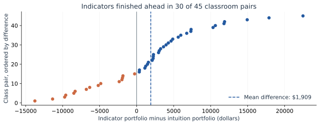
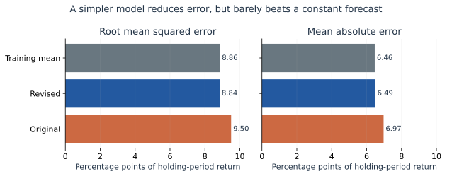
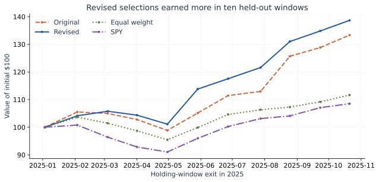

If a stock model makes smaller forecasting errors, should we trust it with money? Our classroom stock game gives this question a useful starting point. I compare its results with a separate historical test: can a simpler version of the classroom gradient-boosting model improve both prediction and portfolio performance?

## What the classroom game showed

The professor’s spreadsheet contains **45 paired final portfolio values**. His R script labels Portfolio 1 as intuition-based and Portfolio 2 as indicator-based. Their averages were **$101,179 and $103,087**. Indicators finished ahead in **30 pairs**, but the mean advantage of **$1,909** came with a paired 95% interval from **−$380 to $4,197**. The two-sided paired-test p-value was **0.100**.

That is suggestive, not decisive. These are outcomes from one shared market episode, not 45 independent market histories. The file does not identify holdings, dates, or which predictions came from XGBoost. It cannot establish that gradient boosting caused the difference. I therefore use it to describe the classroom experiment, then evaluate the model separately.

## Give the revised model a fair test

Gradient boosting builds small decision trees sequentially, with each new tree correcting earlier prediction errors. The classroom script uses 300 trees, depth five, a learning rate of 0.05, and price, volume, momentum, volatility, and market-return information.

I reproduce those main settings in Python. The retained universe contains **95 classroom stocks**, plus SPY as a market comparator. One requested ticker, BK, failed retrieval and was excluded before fitting. Yahoo adjusted prices cover 2022 through October 2025. This is a historical reconstruction, not the exact class-time model artifact.

Both models train on **2022–2023**. I remove observations whose future-return labels cross into the next period. **2024** chooses among four revised specifications; **2025** remains untouched until final evaluation. Both models keep the same training observations, without refitting on validation data.

The revision drops nominal price and volume levels, keeps six return-based signals, and expresses momentum in the forward direction. Validation selects **100 trees of depth two**, with stronger regularization. These joint changes attempt to reduce overfitting; this comparison cannot identify which change helped most.

## Smaller errors do not guarantee useful forecasts

The target is the adjusted-close return from the next trading day’s close to the close 20 trading days after the signal: **19 daily return intervals**. On **17,955 held-out stock-date observations**, revised RMSE is **8.84 percentage points**, versus **9.50** for the original settings. Lower is better.

Yet a constant forecast scores **8.86 points**. The revised model barely improves that benchmark and has slightly worse mean absolute error. Its direction accuracy is **53.0%**, below the constant forecast’s **55.8%**. Large errors show how much return variation these price-based signals leave unexplained. Learning past patterns can mistake noise for a relationship that will persist. Overlapping targets and common market movements also mean these observations are not independent evidence of forecasting skill.

## Would the selections have made money?

Every 20 trading days, I select each model’s ten highest forecasts and weight them by positive predicted returns. Trading begins at the next close. All strategies use identical holding windows, with a cash gap between them. I charge **10 basis points per side**—0.1% to buy and again to sell—and fully liquidate each window.

The revised portfolio gains **38.7%**, against **33.3%** for the original, **11.7%** for equal-weighting all stocks, and **8.5%** for matched-window SPY. Genuine buy-and-hold SPY over the same endpoints gains **14.2%** after one purchase and sale. At 25 basis points per side, the revised gain falls to **34.6%**.

These gains are economically large within this test, but ten windows and a retrospectively supplied stock universe cannot establish persistent skill. Survivorship bias, changing relationships, and unmodeled execution costs remain. The practical lesson is narrower: simplifying helped relative to the classroom settings here, while beating a trivial forecasting benchmark remained difficult. Portfolio gains deserve a separate test, not an automatic endorsement from lower prediction error.

## Sources and replication

Classroom sources: professor-supplied portfolio spreadsheet, results R script, and original XGBoost script. Market source: [Yahoo Finance](https://finance.yahoo.com/). Methods: [XGBoost parameters](https://xgboost.readthedocs.io/en/stable/parameter.html) and [time-ordered model validation](https://scikit-learn.org/stable/modules/cross_validation.html#time-series-split). [Code, frozen data, detailed assumptions, and saved results](https://github.com/ywang818-max/website/tree/main/blog/posts/post9).
